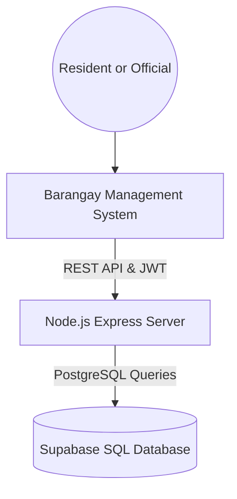

# Barangay Management System

This project reuses the existing MISLend dashboard layout and styles for barangay services.

Residents can manage their household information and submit certificate, clearance, complaint, incident, and appointment requests. Barangay officials receive role-specific dashboards backed by the Express API and Supabase/PostgreSQL.

---

## 🏗️ Architecture Overview

The application uses:
- **Frontend**: Existing responsive HTML, JavaScript, and CSS dashboard components.
- **Backend**: **Node.js + Express** REST API server (`server/index.js`).
- **Database**: **Supabase SQL (PostgreSQL)** with barangay tables and development seed accounts (`server/schema.sql`).
- **Local fallback**: JSON-backed data store for local development.



---

## ✨ Key Features

### Residents
Dashboard, profile and household records, certificate and clearance requests, complaints, incident reports, appointments, transactions, announcements, notifications, and account settings.

### Barangay officials
- **Kagawad**: committee assignments, limited resident records, complaints, projects, activity and incident monitoring, and announcements.
- **Treasurer**: financial overview, income, expenses, budgets, collections, payments, reports, and audit records.
- **Secretary**: resident and household records, certificates, blotter and complaint records, minutes, documents, reports, and announcements.
- **Tanod**: incidents, patrol logs, blotter assistance, emergencies, and assigned schedules.
- **Captain**: resident and household records, officials, approvals, blotters, finance, reports, announcements, and meetings.
- **Superadmin**: access to the combined official dashboards.

---

## 🛠️ Technology Stack

| Layer | Technology |
| :--- | :--- |
| **Frontend** | JavaScript (ES6+), CSS3, HTML5 |
| **Styles** | Vanilla CSS (Modern UI/UX with smooth animations) |
| **Backend** | Node.js, Express, JWT, Bcrypt |
| **Database** | Supabase SQL (PostgreSQL) |
| **Icons** | Font Awesome 6.5.0 |
| **Fonts** | Sora, DM Sans (Google Fonts) |

---

## 🚀 Quick Setup Guide

### 1. Start the Node.js Backend Server

Open your terminal in the `server` directory and run:

```bash
cd server
npm start
```

The server starts on `http://localhost:3000`.

> **Note:** The server includes an automatic local storage fallback. You can immediately open and use the application even before setting up Supabase!

### Deploy the app and API to Vercel

The repository includes a Vercel API function that serves the Express backend at `/api` alongside the static frontend. Import the repository into Vercel with the project root set to the repository root, then add these Environment Variables in **Project Settings > Environment Variables** for every deployment environment:

- `SUPABASE_URL`
- `SUPABASE_SERVICE_ROLE_KEY` (or `SUPABASE_ANON_KEY`)
- `JWT_SECRET` (use a new, randomly generated secret; do not use the development fallback)
- `TURNSTILE_SITE_KEY`
- `TURNSTILE_SECRET_KEY`

Registration requires Cloudflare Turnstile. Create a Turnstile widget for your deployed hostname, then set its site key as `TURNSTILE_SITE_KEY` and its secret key as `TURNSTILE_SECRET_KEY`. The site key is public; keep the secret key server-side and never put it in frontend code. Missing either key prevents registration. Add the variables to each Vercel environment where the app is deployed and redeploy after setting them.

Add the SMTP variables below as well if password verification emails are needed. Verify the deployment by opening `https://<your-vercel-domain>/api/status`; it should return JSON with `"status":"online"` and `"database":"supabase_sql"`. The frontend uses the same-origin `/api` route, so it does not need a separate API URL. Do not deploy with local fallback storage: Vercel functions do not provide persistent local-file storage.
Also set `APP_BASE_URL` to the public HTTPS URL of the deployed site. Password reset links point back to that site.

### Configure email delivery

Password verification and reset email delivery use SMTP. Copy [`server/.env.example`](server/.env.example) to `server/.env` if available, then set the required app, Turnstile, and SMTP settings.

### Local files and secrets

The repository-root `.gitignore` excludes environment files, installed dependencies, local runtime data, logs, and common generated or operating-system files. Keep real credentials in `server/.env` (or the appropriate local `.env` file); commit only example templates such as `server/.env.example`. Never put real passwords, API keys, or service-role keys in source code or this README. Before deploying, replace or remove all demo account credentials and use unique production secrets.

### 2. Connect to Your Supabase SQL Database

When you are ready to connect to your live Supabase project:

1. Create a project at [Supabase Dashboard](https://supabase.com/dashboard).
2. Go to the **SQL Editor** tab in Supabase.
3. Open [`server/schema.sql`](server/schema.sql), copy it into the SQL Editor, and click **Run**. It creates or upgrades the resident account columns, converts existing MISLend student/professor accounts to resident/captain roles, creates barangay service tables, and inserts two development accounts.
4. Go to **Project Settings > API** in Supabase and copy:
   - **Project URL**
   - **anon / public key** or **service_role key**
5. Open [`server/.env`](server/.env) and update your credentials:
   ```env
   SUPABASE_URL=https://YOUR_PROJECT_ID.supabase.co
   SUPABASE_ANON_KEY=YOUR_SUPABASE_ANON_KEY
   SUPABASE_SERVICE_ROLE_KEY=YOUR_SUPABASE_SERVICE_ROLE_KEY
   ```
6. Restart the backend server (`npm start`). It will automatically connect directly to Supabase SQL!

---

## Development Seed Accounts

The SQL seed accounts are development-only:

| Role | Username | Email | Password |
|---|---|---|---|
| Resident | `residentdemo` | `resident.demo@barangay.local` | `Resident123!` |
| Superadmin | `superadmin` | `superadmin.demo@barangay.local` | `Barangay123!` |

Change both passwords before deployment. Public registration creates resident accounts; official accounts are created by the captain or superadmin.
